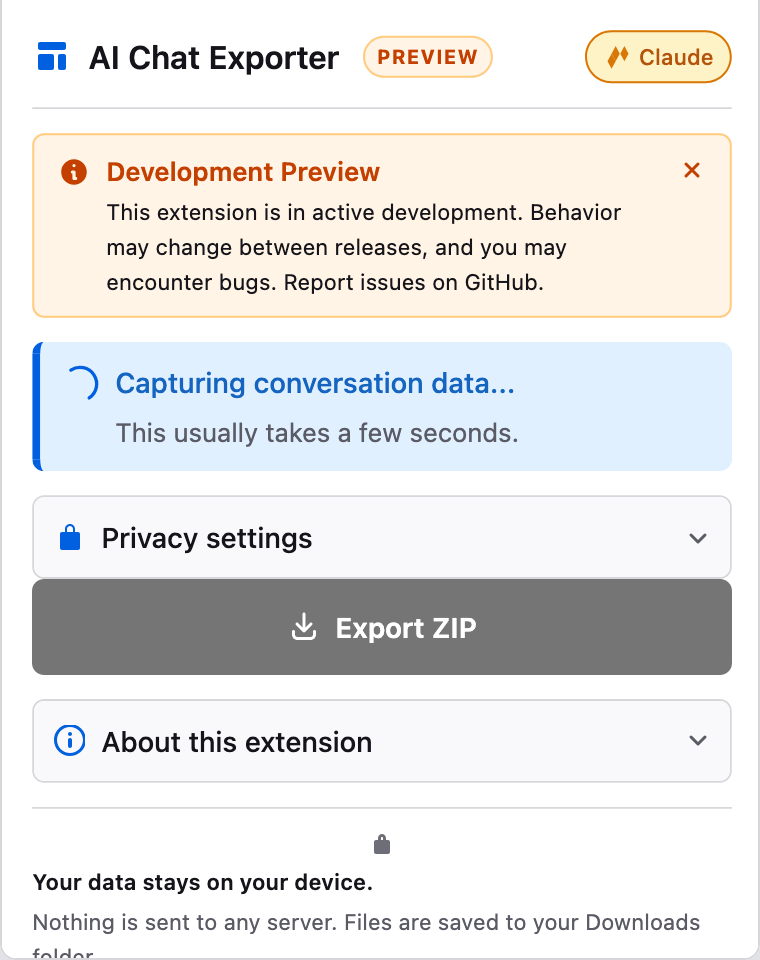
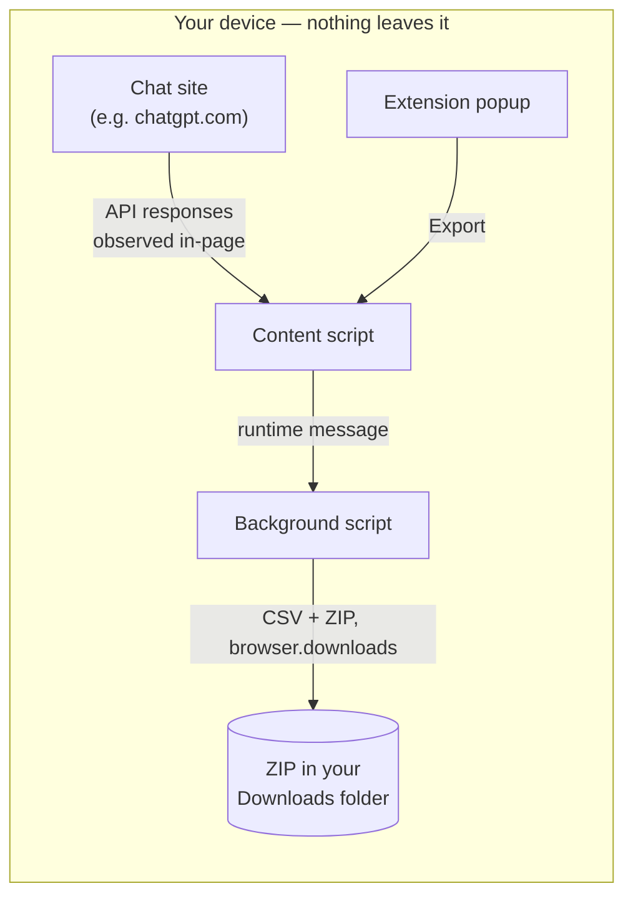

<div align="center">


# AI Chat Exporter

Export your AI chat conversations to CSV, entirely on your own device.

[](https://addons.mozilla.org/firefox/addon/local-ai-chat-exporter/)
[](https://addons.mozilla.org/firefox/addon/local-ai-chat-exporter/)
[](https://github.com/dj-urg/AI-Dialogue-Insight-Extension/actions/workflows/ci.yml)
[](#license)

### [Install from Firefox Add-ons &rarr;](https://addons.mozilla.org/firefox/addon/local-ai-chat-exporter/)

</div>

> [!WARNING]
> **Development Preview.** This extension is in active development. Behaviour may change between releases, and you may encounter bugs. Please verify your exports before using them in a study, and report issues on the [GitHub tracker](https://github.com/dj-urg/AI-Dialogue-Insight-Extension/issues).

<div align="center">

<picture>
  <source media="(prefers-color-scheme: dark)" srcset="docs/images/popup-dark.png" />
  
</picture>

</div>

## For participants and students

If a researcher asked you to install this extension, here is the whole process:

1. **[Install from the Firefox Add-ons site.](https://addons.mozilla.org/firefox/addon/local-ai-chat-exporter/)** The icon will appear in your toolbar.
2. **Open the AI chat you want to share** on one of the [supported sites](#supported-platforms).
3. **Click the extension icon.** The popup tells you what will be exported.
4. **(Optional) Open "Privacy settings"** to turn on PII scrubbing or enter a study code before you export.
5. **Click "Export ZIP."** A single ZIP file is saved to your Downloads folder.
6. **Review the export.** The popup then asks you to open the ZIP and check what's in it before sharing it; "Show in Downloads" reveals the file. Send it to the researcher by whatever channel they told you to use.

Nothing is uploaded anywhere by the extension. The ZIP sits in your Downloads folder until you decide what to do with it.

<details>
<summary>Install from source (for development only)</summary>

1. Clone or download this repository.
2. In Firefox, open `about:debugging#/runtime/this-firefox`.
3. Click **Load Temporary Add-on&hellip;** and select this project's `manifest.json`.

The temporary install is wiped when you close Firefox — use the Add-ons store build for day-to-day use.

</details>

## Supported platforms

| Platform | Sites | What gets exported |
|---|---|---|
| **ChatGPT** | `chatgpt.com`, `chat.openai.com` | Metadata, per-node messages (with thoughts, reasoning, tool output), cited sources, in-message URLs, donor context (opt-in), canonical messages |
| **Claude** | `claude.ai` | Metadata, per-content-block messages, citations, attachments, canonical messages |
| **Copilot** | `copilot.microsoft.com`, `copilotstudio.microsoft.com` | Conversation messages, canonical messages |
| **Microsoft&nbsp;365 Copilot** | `m365.cloud.microsoft` | Conversation messages, cited sources, canonical messages |
| **Perplexity** | `www.perplexity.ai` | Metadata, messages, sources, canonical messages |
| **Grok** | `grok.com` | Metadata, messages, sources, canonical messages |
| **DeepSeek** | `chat.deepseek.com` | Metadata, messages, sources, canonical messages |
| **Mistral** | `chat.mistral.ai` | Metadata, messages, sources, canonical messages |
| **Google AI Overview / AI Mode** | `google.com` and nine country domains (`.be`, `.nl`, `.fr`, `.de`, `.co.uk`, `.es`, `.it`, `.ca`, `.com.au`) | AI Overview text or AI Mode turns, source URLs, canonical messages |

Full column schemas live in [`METHODS.md`](METHODS.md) and [`STUDENT_GUIDE.md`](STUDENT_GUIDE.md).

## How it works



The extension hooks the chat site's own `fetch` calls (a WebSocket on Microsoft 365 Copilot, the rendered page on Google), reads the conversation payload the site has already loaded for you, and, when you click Export, hands it to the background script, which formats it as CSV, bundles the CSVs plus a manifest with SHA-256 checksums into a ZIP, and triggers a browser download. There is no server component.

**What the extension does *not* do:**

- No requests to anyone but the chat site you are on. The popup and background make no network requests at all (CSP `connect-src 'none'`); the per-site content scripts only make same-origin requests to that site, such as re-fetching the conversation you have open through the site's own API. On DeepSeek that request carries the site's own login token read from the page's local storage, because DeepSeek rejects cookie-only requests; it is made when the popup opens (at most once every 30 seconds while it stays open) and at export, and the token is never stored or exported. On Google the search page you are viewing is re-requested at most once per page and query.
- No telemetry, analytics, or crash reporting.
- No account linking. The `donor_id` is a UUID generated locally on first use, never tied to your ChatGPT / Claude / Microsoft / Google account.
- No DOM scraping of chat sites. The exporter uses the site's own API payloads. That means the export can hold slightly more than the screen shows: edited prompts and regenerated answers are included and marked with `on_visible_path`. The one exception to API-based capture is Google Search, where the AI Overview exists only as rendered HTML and is read from the page.

**Permissions, and why:**

| Permission | Reason |
|---|---|
| `activeTab` | Read the URL of the tab you clicked the icon on, so the popup knows which platform you are on. The toolbar icon state uses the host permissions below instead of the `tabs` permission, which this release does not request. |
| `scripting` | Re-inject the Perplexity scripts at navigation time as a fallback when the manifest entry does not take effect (Perplexity only; every other site uses ordinary manifest content scripts). |
| `downloads` | Save the ZIP to your Downloads folder. |
| `storage` | Remember your privacy settings and the local `donor_id` across exports. |
| `host_permissions` | Limited to the ten supported chat site hosts plus the ten Google search domains listed in `manifest.json`. |

## What's inside the ZIP

Every export is a single ZIP named `{platform}_{conversation_id_short}_{timestamp}.zip`. Inside, each CSV repeats that slug so individual files can be traced back to the ZIP (and manifest) they came from:

```
claude_c6a2d8dc_2026-10-13T11-58-12Z.zip
├── claude_metadata_…csv            — one row, conversation-level
├── claude_messages_…csv            — one row per content block
├── claude_sources_…csv             — one row per citation (only if present)
├── claude_attachments_…csv         — one row per uploaded file (only if present)
├── claude_messages_canonical_…csv  — one row per message, cross-platform shape
└── claude_manifest_…json           — checksums, row counts, validation summary
```

Every CSV is UTF-8 with BOM and RFC 4180–quoted. Every platform-specific CSV starts with the same five donor columns: `schema_version`, `extractor_version`, `donor_id`, `donor_id_type`, `download_time`; the canonical CSVs use the fixed 14-column layout below instead (donor type and download time live in `platform_specific_json`).

Every platform also emits a **canonical messages CSV** with the same 14 columns in the same order, so corpora can be pooled across platforms without a bespoke join:

> `donor_id`, `platform`, `conversation_id`, `message_id`, `parent_message_id`, `turn_index`, `role`, `text`, `text_cleaned`, `created_at_iso`, `model_identifier`, `schema_version`, `extractor_version`, `platform_specific_json`

See [`METHODS.md`](METHODS.md) for extraction choices and [`STUDENT_GUIDE.md`](STUDENT_GUIDE.md) for the full per-column reference, confidence annotations, and common pitfalls.

## Security & privacy

The real risk is that your past chats may contain sensitive content you've forgotten about. The extension does not try to attack you, and does not expose you to anything beyond what visiting the chat site already does.

- **Everything runs locally.** The extension reads the chat site's own API responses, writes them to a ZIP, and saves it via the browser's download API. The extension-page CSP sets `connect-src 'none'`, so the popup and background cannot make requests; content scripts only talk to the site they run on. No telemetry, no server component, zero runtime npm dependencies.
- **The page↔extension bridge is HMAC-signed** ([`shared/message-security.js`](shared/message-security.js)) — stops other scripts on the same tab from injecting fake data. It does *not* protect against the chat site itself; that site already has your conversation, so trusting it with the extraction is unavoidable by design.
- **Updates ship through Mozilla.** No `update_url` in `manifest.json`, so updates flow through [addons.mozilla.org](https://addons.mozilla.org/firefox/addon/local-ai-chat-exporter/) and are signed by Mozilla. Integrity depends on the publisher's AMO account (2FA enabled).
- **PII scrubbing is pattern-based** ([`utils/pii.js`](utils/pii.js)) — matches emails, phones, IP addresses, API keys, credit cards, SSNs, long tokens, in every file of the ZIP when it is on (canonical CSV and raw-JSON columns included). Misses free-text names, addresses, employer names, medical narrative. A reduction in exposure, not a guarantee. On/off is a per-study decision that must match the consent text.

**Why ten Google locale permissions?** The Google Search content script only runs on `/search*` paths (and does nothing on the rest of Google) to read AI Overview text that is already visible in the page you're viewing; no search queries are sent anywhere by the extension. The locale set — `.com`, `.be`, `.nl`, `.fr`, `.de`, `.co.uk`, `.es`, `.it`, `.ca`, `.com.au` — covers the European and English-speaking populations this release targets. Firefox will prompt existing users to approve the new permissions on update because the host list and the `scripting` permission are new.

## How this tool is verified

CI runs the Node test suite on every push (unit tests, byte-exact golden exports through the real `background.js` for all nine platforms with scrubbing off and on, a PII sweep that plants secrets in every fixture and searches every ZIP entry, schema, version, message-security and settings checks) plus ESLint, `web-ext lint` and a secret scan. Before a release the maintainer also runs the `web-ext build` check and the Playwright/axe accessibility baseline of every popup state locally. Exports are additionally compared against real captures with an external toolkit. [`docs/validation.md`](docs/validation.md) lists the tests, the last results, the real-data method and its log, and what is not yet validated.

## For researchers

- **[`METHODS.md`](METHODS.md)** — how each platform is captured and extracted, branches and the visible path, what reasoning text each platform exposes, the `text_cleaned` and CSV format rules, donor identity, the consent record and the manifest. Cite this in your methods section.
- **[`STUDENT_GUIDE.md`](STUDENT_GUIDE.md)** — a per-column walk-through for donors and research assistants, written to make a received export legible on its own.

**Donor identity.** `donor_id` is a UUID generated on first use and stored in `browser.storage.local`. If a donor enters a **study code** (salt) in Privacy settings, every `donor_id` in the ZIP becomes `HMAC-SHA256(uuid, salt)` — the same donor across different studies yields different IDs, so exports from studies that use different codes cannot be joined on `donor_id`.

**PII scrubbing is best-effort.** The optional pass in [`utils/pii.js`](utils/pii.js) targets emails, phone numbers, IPv4 addresses, JWTs, bearer tokens, provider-prefixed keys (`sk-…`, `AKIA…`, `AIza…`, etc.), credit-card-shaped numbers (Luhn-checked), US SSNs, and long opaque tokens, in every file of the ZIP; identifiers, timestamps and URLs are preserved so files stay joinable (see "PII scrubbing coverage" in `METHODS.md`). Scrubbed values are replaced with tagged placeholders (`<REDACTED:EMAIL>`, …) and counted in the manifest. It will miss names, addresses, and anything that doesn't match these patterns. Treat it as a reduction in exposure, not a guarantee.

**How to cite.** The repository ships a [`CITATION.cff`](CITATION.cff), so GitHub shows a "Cite this repository" button in the sidebar. BibTeX / APA export is generated from that file.

## Development

<details>
<summary>Local setup &amp; running the extension</summary>

```bash
git clone https://github.com/dj-urg/AI-Dialogue-Insight-Extension.git
cd AI-Dialogue-Insight-Extension
npm install
npm run lint          # ESLint
npm run lint:web-ext  # web-ext lint
npm test              # Node test runner
npx web-ext run       # Launch Firefox with the extension loaded
```

Requires Node 20+.

</details>

<details>
<summary>Preview harness (popup UI, no live chat required)</summary>

The `dev/` directory contains a static HTML harness that renders the popup in every possible state (supported, ready, loading, each error, consent gate) over mocked `browser.*` APIs. All fixtures are synthetic — no real conversations.

```bash
python3 -m http.server 8766
# then open http://localhost:8766/dev/harness.html
```

The harness supports light/dark/forced-theme switching and 320 / 380 / 600 px viewports for responsive checks. See [`dev/README.md`](dev/README.md). The harness is excluded from `web-ext build`.

</details>

<details>
<summary>Visual regression baselines</summary>

```bash
npm run baseline            # capture the current popup states to dev/baselines/
npm run baseline:compare    # diff against the previous capture
```

Baseline PNGs and axe reports are gitignored (`dev/baselines/`); only the script is checked in.

</details>

## License

No license file is checked in yet. Until one is added, treat the code as "all rights reserved" and open an [issue](https://github.com/dj-urg/AI-Dialogue-Insight-Extension/issues) if you want to reuse it. A permissive license will be added before the first stable Add-on release.

## Contact

Maintainer: Daniel Jurg — Vrije Universiteit Brussel. Bugs, extraction regressions, and schema questions all go to the [issue tracker](https://github.com/dj-urg/AI-Dialogue-Insight-Extension/issues).
