# Analysing donated AI chats with 4CAT: a step-by-step guide

This guide is for students who have never used [4CAT](https://4cat.nl)
before. It walks you click by click through four small analyses of donated
chatbot conversations. Each one ends in a real result. No programming is
needed.

**What you will find:**

1. Each AI assistant has its own way of talking.
2. Each assistant sends people to different websites.
3. A social-media trend shows up in people's questions, and disappears again.
4. Which assistants people use most.

> **All data in this guide is synthetic.** The *Wellness Month* case has 18
> invented participants who donated their ChatGPT, Claude, Gemini and Google
> AI Overview conversations about health for one month (October 2026): 3,470
> messages and 2,688 links the assistants cited. The patterns were planted on
> purpose, so that you can practise finding them. You would find them in
> real data in exactly the same way.

## Contents

- [Before you start: how 4CAT works](#before-you-start-how-4cat-works)
- [Part 1: Upload the data](#part-1-upload-the-data)
- [Part 2: Which assistants do people use?](#part-2-which-assistants-do-people-use)
- [Part 3: Each assistant has its own voice](#part-3-each-assistant-has-its-own-voice)
- [Part 4: A trend that lasts one week](#part-4-a-trend-that-lasts-one-week)
- [Part 5: Each assistant cites different websites](#part-5-each-assistant-cites-different-websites)
- [More ideas to try](#more-ideas-to-try)
- [Common problems](#common-problems)

---

## Before you start: how 4CAT works

You need three things:

- A **4CAT account**. Your teacher or research group gives you the address
  and login. This guide uses a 4CAT server at a university; yours may look
  slightly different, but the buttons are the same.
- The two files from the extension's **merge page**: open the merged ZIP
  file and find `all_messages_canonical_4cat.csv` (the messages) and
  `all_sources_canonical.csv` (the websites the assistants linked to).
  For practice, use the synthetic files
  `wellness_month_oct2026_all_messages_canonical_4cat.csv` and
  `wellness_month_oct2026_all_sources_canonical.csv`, made with
  `python3 dev/synthetic-4cat/gen.py`.
- About an hour.

Three words you will see all the time:

| Word | What it means |
| --- | --- |
| **Dataset** | A file you uploaded, now stored in 4CAT. Each row is one message (or one cited link). |
| **Processor** | A tool that does one thing with a dataset: count, filter, split text into words, draw a chart. All processors are listed at the bottom of a dataset's page. |
| **Result** | What a processor produces: a table, a chart or a new, smaller dataset. Results appear under **Analysis results** on the dataset's page. |

**How to run any processor** (you will do this many times):

1. On the dataset's page, scroll down to **Processors** and find the
   processor by its name.
2. Click the grey **Options** button on its left. The settings open, and
   the button turns into a blue **Run** button.
3. Fill in the settings.
4. Click **Run**. After a few seconds to a minute, the result appears under
   **Analysis results** near the top of the page. Refresh the page if it
   does not appear.

---

## Part 1: Upload the data

You upload the messages file first. Later, in Part 5, you upload the sources
file the same way.

**Step 1.** Click **Create dataset** in the menu at the top.

**Step 2.** Fill in the top of the form:

- **Data source:** choose *Import/upload CSV file*.
- **File:** click *Choose file* and select the messages file
  (`..._all_messages_canonical_4cat.csv`).
- **CSV format:** choose *Custom/other*.
- Leave **Strip HTML?** unticked.

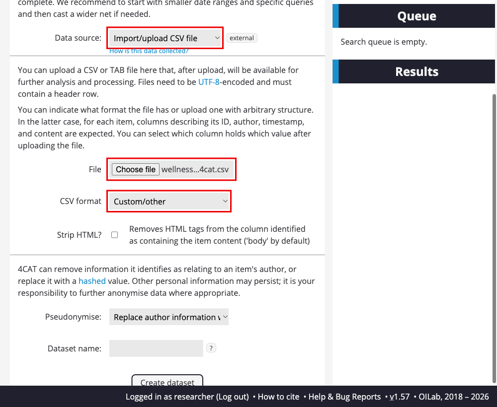

**Step 3.** Type a **Dataset name** at the bottom, for example
`wellness-oct2026-messages`, and click **Create dataset**. 4CAT does not
create the dataset yet: it first reads the file and asks which column is
which.

**Step 4.** Match 4CAT's five fields to the columns of the file, exactly like
this:

| 4CAT asks for | Choose |
| --- | --- |
| id | *[generate sequential IDs]* |
| thread_id | `conversation_id` |
| author | `donor_id` |
| body | `text_cleaned` |
| timestamp | `created_at_iso` |

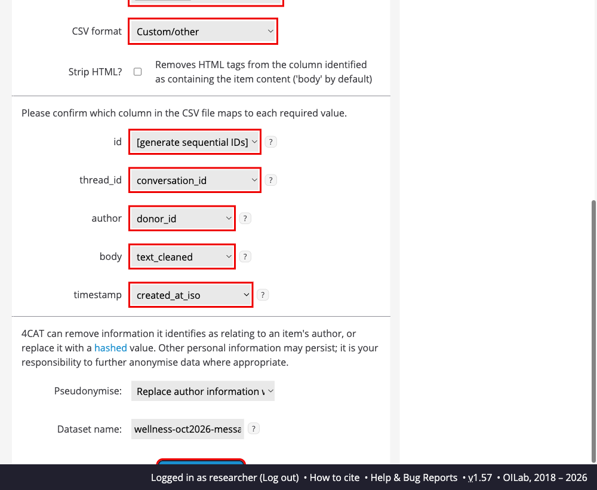

`text_cleaned` is the message text without formatting symbols such as `**`.
`donor_id` is a code for the participant; it is not their name.

**Step 5.** Click **Create dataset** again. After a few seconds, 4CAT says
*Query complete*. Click the dataset's name under **Results** on the right to
open it.

**Step 6.** Check the dataset page. Under **Result** it should say *3,470
items captured*. It will also say that some items had no timestamp: that is
normal, because not every platform records a time for every message. Click
**Preview** to look at the first rows.

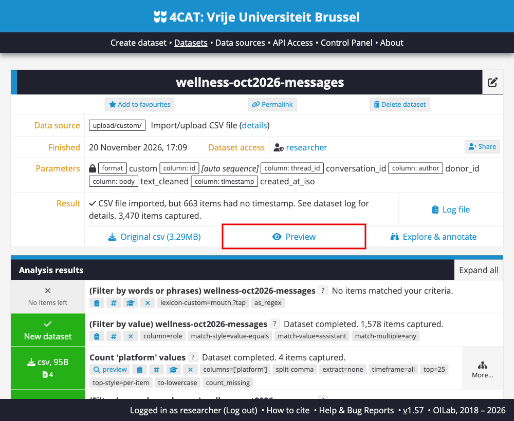

> **Do not upload `all_messages_canonical.csv`** (the file without `_4cat`).
> It has an extra column that 4CAT cannot read, and the upload will fail.

---

## Part 2: Which assistants do people use?

The simplest analysis: count how many messages come from each platform.

**Step 1.** On the dataset page, scroll down to **Processors → Metrics** and
find **Count values**. Click **Options**.

**Step 2.** Under *Column(s) to count*, **untick `body`** (it is ticked by
default) and **tick `platform`**. Leave everything else as it is.

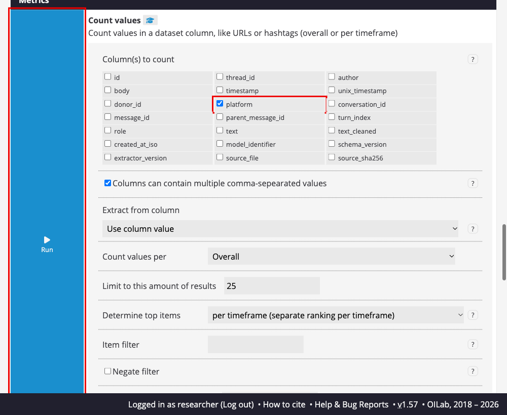

**Step 3.** Click **Run**. Wait until the result appears under **Analysis
results**, then click **preview** to see the table.

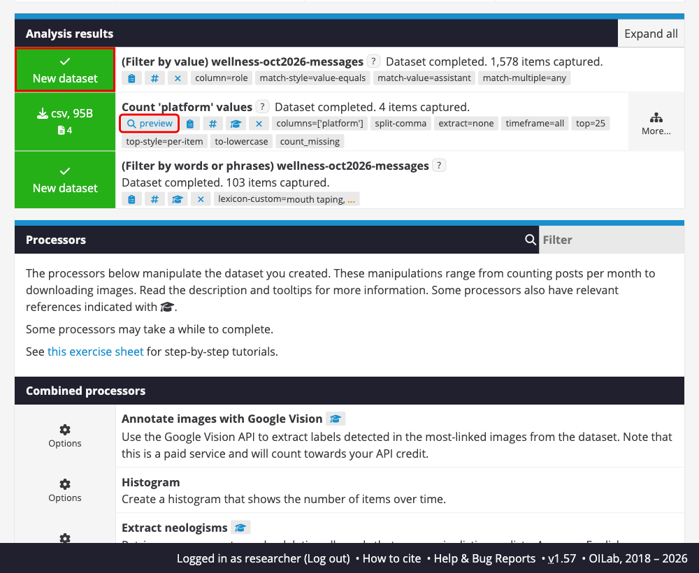

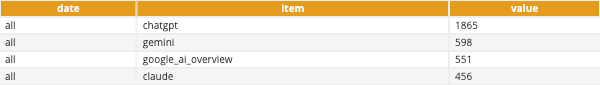

**What you see:** ChatGPT accounts for 1,865 of the 3,470 messages (54%),
Gemini for 598, Google AI Overview for 551 and Claude for 456. Most
participants use ChatGPT, so in later comparisons remember that ChatGPT
simply has more data.

**Try it yourself:** run **Count values** again with `donor_id` ticked
instead. You will see that a few people wrote many more messages than the
others.

---

## Part 3: Each assistant has its own voice

Do the four assistants give the same advice in the same words? To find out,
you keep only the assistants' answers, split them into words, and count the
words per platform.

### Step A: keep only the assistants' answers

Each message has a `role`: `user` (what the participant typed) or
`assistant` (the AI's answer).

1. On the dataset page, go to **Processors → Filtering → Filter by value**
   and click **Options**.
2. Set **Column** to `role`, **Match type** to *is equal to* and **Match
   with** to `assistant`.
3. Click **Run**.

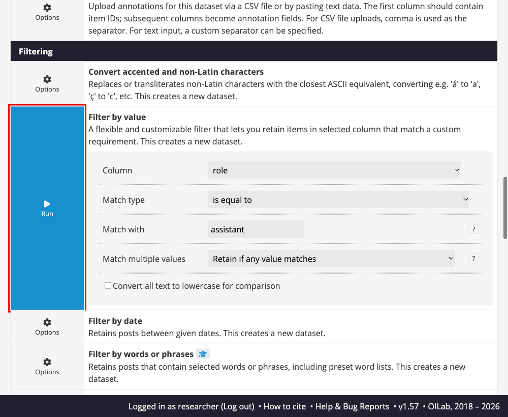

A filter does not make a table: it makes a **new, smaller dataset**. When it
is done, a green **New dataset** button appears under **Analysis results**
(see the screenshot in Part 2). Click it to open the new dataset. It has
1,578 messages: only the answers. You can also find it on the **Datasets**
page, where it is called *(Filter by value) wellness-oct2026-messages*.

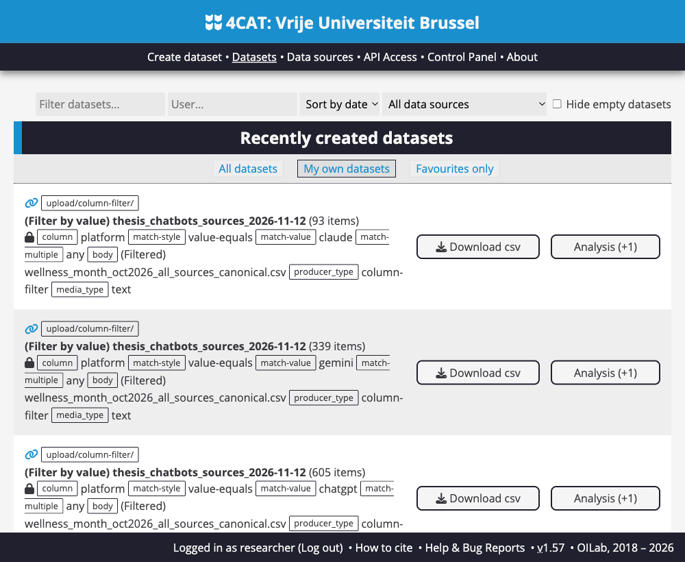

### Step B: split the answers into words ("tokenise")

Computers count words more easily once each message is split into a list of
words. This is called **tokenising**.

1. On the page of the **new** dataset (the 1,578 answers), go to
   **Processors → Text analysis → Tokenise** and click **Options**.
2. Under *Column(s) to tokenise*, tick **`body`**.
3. Keep **Language** on *English*.

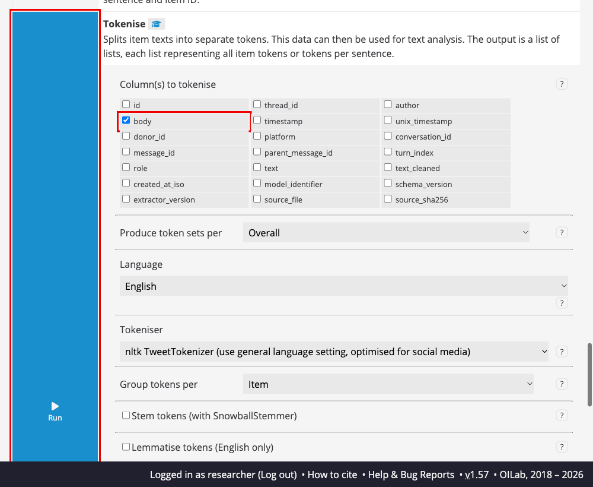

4. Scroll down to **Tokens to exclude** and tick **Stop words for language
   chosen above**. Stop words are very common words such as *the*, *and* and
   *is*, which would otherwise top every list.
5. Click **Run**.

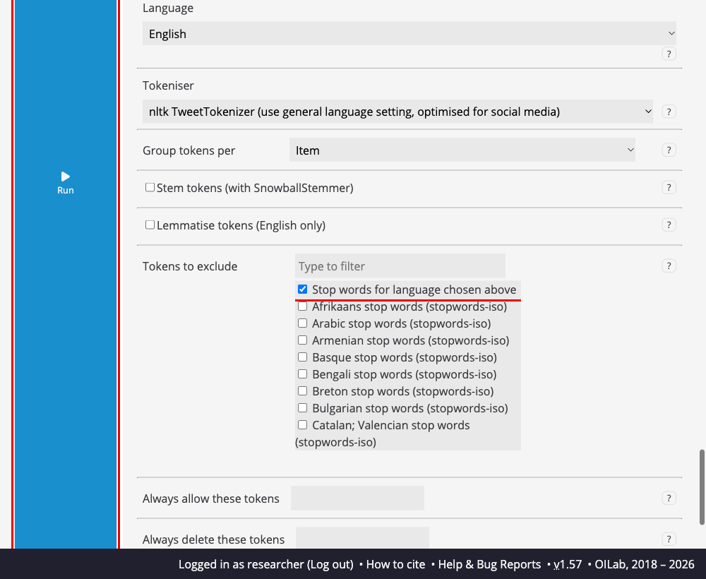

### Step C: count the words per platform

1. When the **Tokenise** result appears under **Analysis results**, click
   **More…** on its right. A list of processors that work on words opens
   underneath.
2. Find **Count words by category** in that list and click **Options**.

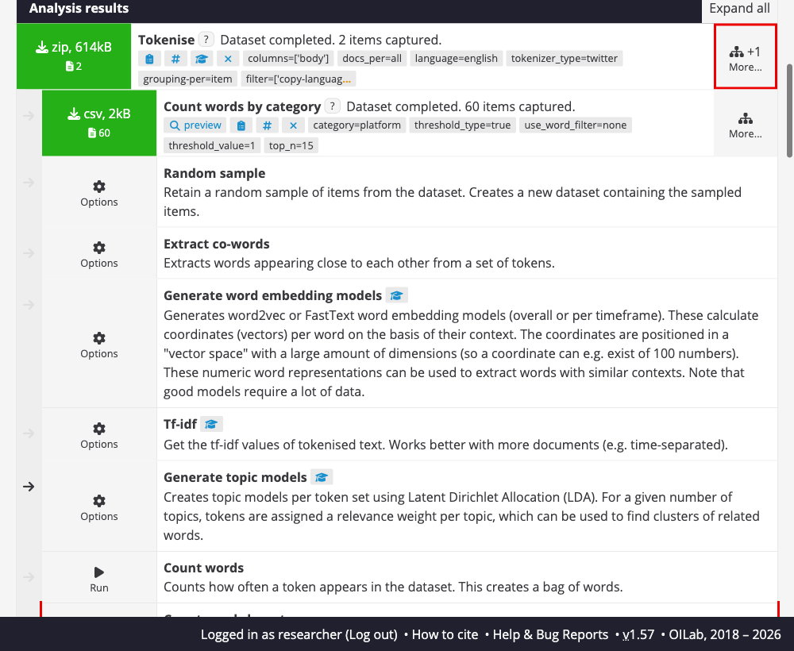

3. Set **Category column** to `platform`. Leave the other settings as they
   are.
4. Click **Run**, then **preview** on the result.

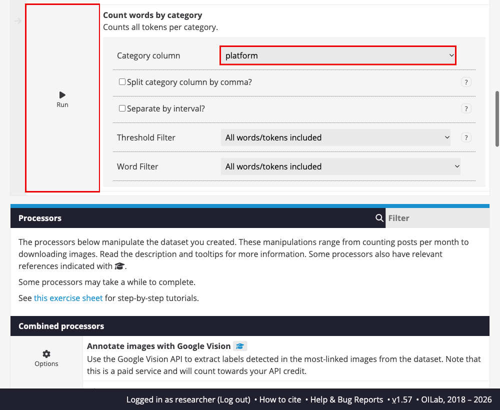

### What you see

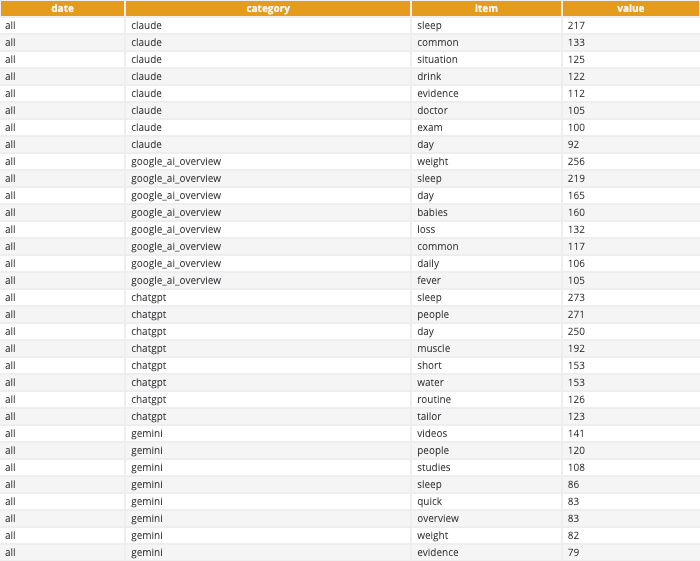

All four talk about the same topics (*sleep*, *weight*, *day*), but the
words around them differ:

- **Claude** is careful and refers people on: *evidence* (112) and *doctor*
  (105) are among its six most frequent words.
- **ChatGPT** offers action: *routine* and *tailor* ("I can tailor a plan
  for you").
- **Gemini** points to videos: *videos* is its single most frequent word
  (141), and *youtube* follows further down the list.
- **Google AI Overview** is short and factual: *weight*, *babies*, *fever*,
  *daily*.

> The table in the screenshot shows each platform's top 8 words. Your preview
> shows more rows; scroll through it, or click the download button on the
> left of the result to open the full table in Excel.

---

## Part 4: A trend that lasts one week

In October 2026, a (fictional) TikTok trend told people to tape their mouth
shut at night for better sleep. Can we see it in what people asked their AI
assistants?

### Step A: keep only messages about mouth taping

1. Go back to the **original** messages dataset (all 3,470 messages).
2. Go to **Processors → Filtering → Filter by words or phrases** and click
   **Options**.
3. In **Custom word list**, type `mouth taping, mouth tape`. The comma means
   "or": a message is kept if it contains either phrase.
4. Leave the three tick boxes unticked and click **Run**.

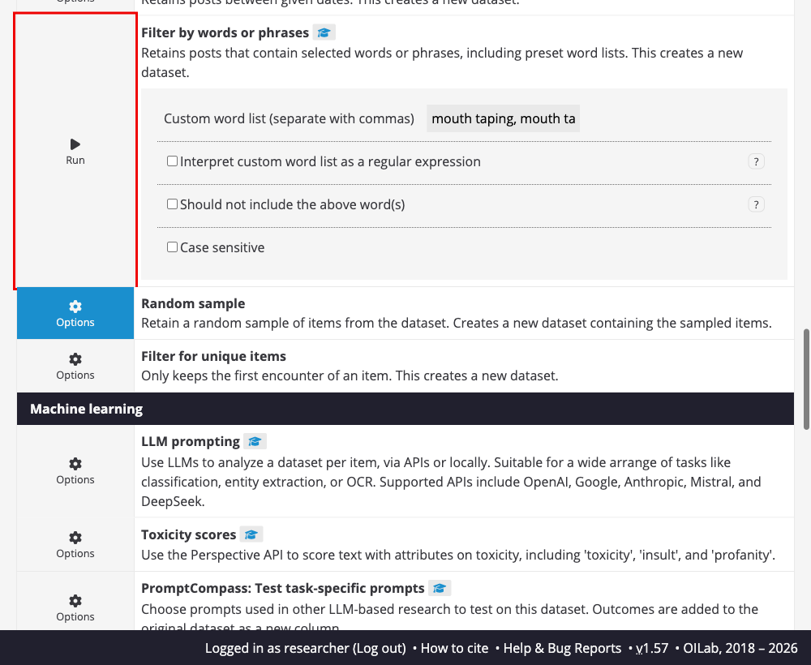

This again makes a **New dataset**, with 103 messages. Open it.

### Step B: count the messages per day

1. On the page of the new dataset, go to **Processors → Combined processors
   → Histogram** and click **Options**.
2. Set **Produce counts per** to *Day*.
3. Click **Run**, then **preview** on the result.

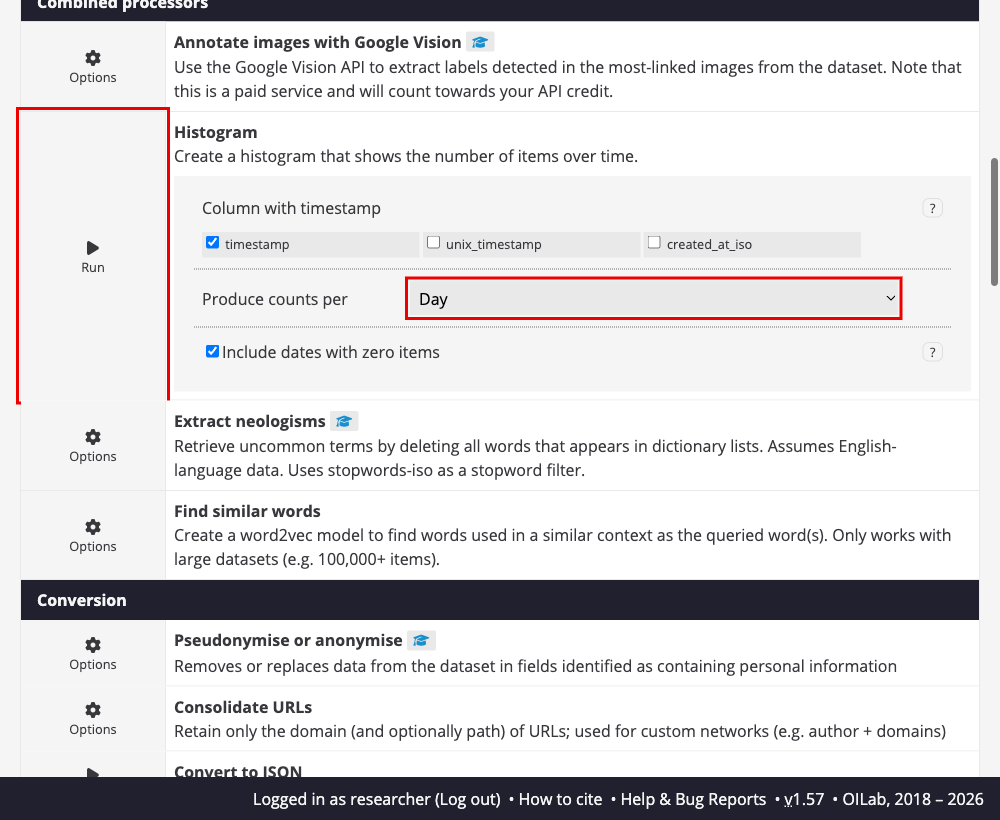

### What you see

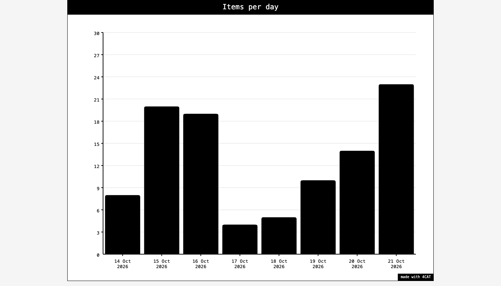

All 103 messages fall between 14 and 21 October; there are none before or
after. It is a trend that lasted one week. Run **Count values** on
`platform` (as in Part 2) on this dataset, and you will see the trend
reached all four assistants: ChatGPT 37, Claude 25, Google AI Overview 23
and Gemini 18.

---

## Part 5: Each assistant cites different websites

The second file lists every link (source) the assistants gave. Which
websites do they send people to?

### Step A: upload the sources file

Repeat Part 1 with the sources file (`..._all_sources_canonical.csv`). Name
it, for example, `wellness-oct2026-sources`, and match the fields like this:

| 4CAT asks for | Choose |
| --- | --- |
| id | *[generate sequential IDs]* |
| thread_id | `conversation_id` |
| author | `donor_id` |
| body | `domain` |
| timestamp | `created_at_iso` |

`domain` is the website's name without the rest of the address, such as
`reddit.com`.

### Step B: keep one platform's links

1. On the sources dataset's page, open **Processors → Filtering → Filter by
   value** and click **Options**.
2. Set **Column** to `platform` and **Match with** to `google_ai_overview`.
3. Click **Run**.
4. Do the same three more times with `chatgpt`, `gemini` and `claude`. You
   now have four new datasets, one per platform. They appear on the
   **Datasets** page; the grey tags show which platform each one holds.

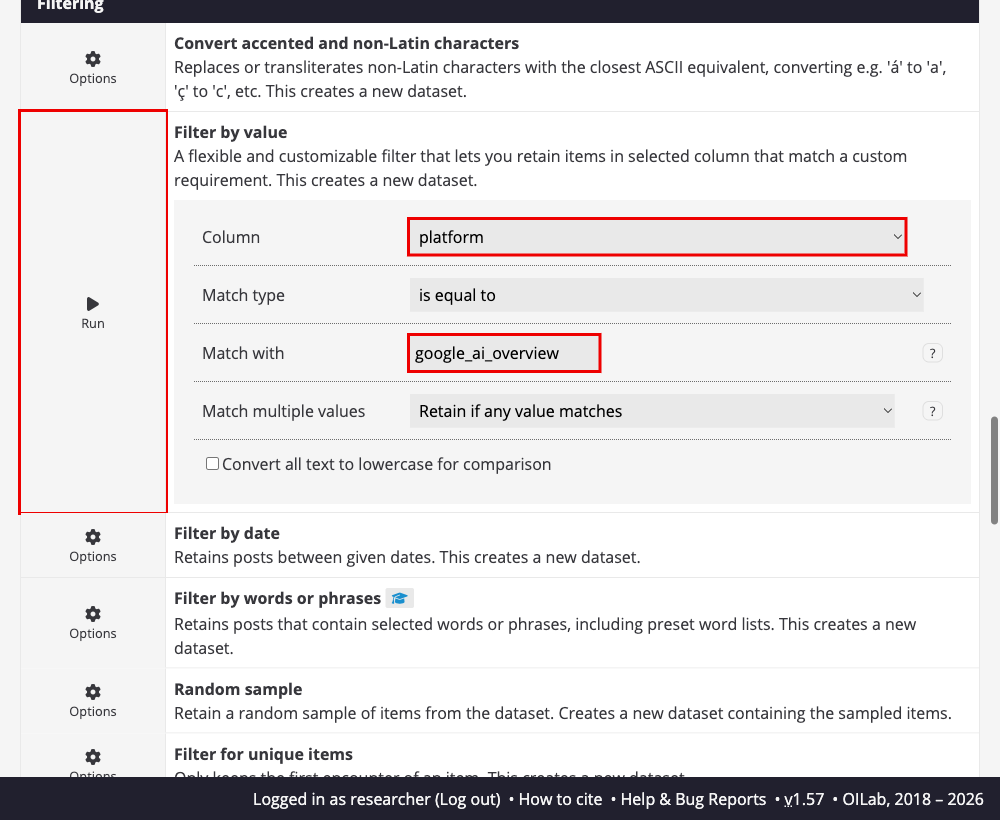

### Step C: count the websites

Open each of the four new datasets and run **Count values** (as in Part 2),
this time with **`domain`** ticked instead of `body`. Click **preview** on
each result.

### What you see

| Google AI Overview (1,651 links) | ChatGPT (605) | Claude (93) |
| --- | --- | --- |
| 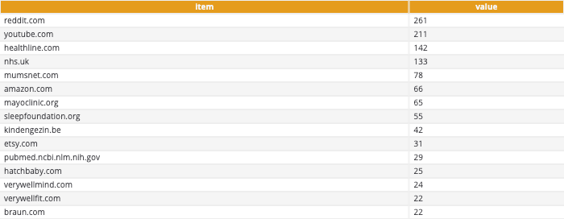 | 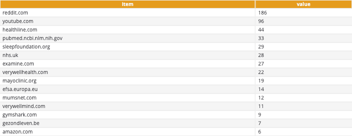 | 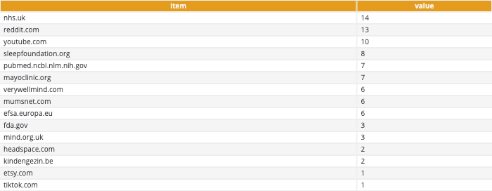 |

- **ChatGPT** relies on forums: reddit.com is cited 186 times, about a third
  of all its links.
- **Google AI Overview** cites shops next to health pages: amazon.com (66),
  etsy.com (31), hatchbaby.com (25) and braun.com (22) are in its top 15.
- **Claude** gives few links (93 in total). nhs.uk is its top source, and
  health and science sites (NHS, Sleep Foundation, PubMed, Mayo Clinic, the
  EU food-safety agency EFSA) make up about 55% of its links, against 22–24%
  for the other platforms.

---

## More ideas to try

Each of these uses only the tools from this guide:

- **One person's story:** use **Filter by value** with `donor_id` and one
  participant's code, then **Tokenise** with *Produce token sets per* set to
  *Week*, and **Count words**. How do their questions change over the month?
- **Night owls:** run **Histogram** with *Produce counts per* set to *Hour*.
  Who asks for advice at 3 am?
- **Shopping:** in the sources dataset, **Filter by value** on `domain` =
  `amazon.com`. Which questions led to a shop?
- **What users ask:** repeat Part 3 with `role` = `user` instead of
  `assistant`.

## Common problems

| Problem | Solution |
| --- | --- |
| The upload says "Couldn't correctly read the file". | You uploaded `all_messages_canonical.csv`. Use the file whose name ends in `_4cat.csv`. |
| A filter says "No items matched your criteria". | Check the spelling, and type complete words or phrases (`mouth taping`, not `mouth tap`). |
| The histogram is missing some messages. | Messages without a timestamp cannot be placed on a timeline. This is normal for some platforms. |
| I clicked Run but nothing appeared. | Processors take from a few seconds to a few minutes. Refresh the page. |
| I can't find the processor. | Type its name in the **Filter** box at the top of the **Processors** list. |

Every result has a download button on its left (for example *csv, 95B*):
click it to continue working in Excel, R or Python. See "Merging exports" in
[`METHODS.md`](../../METHODS.md) for what each column in the files means.
